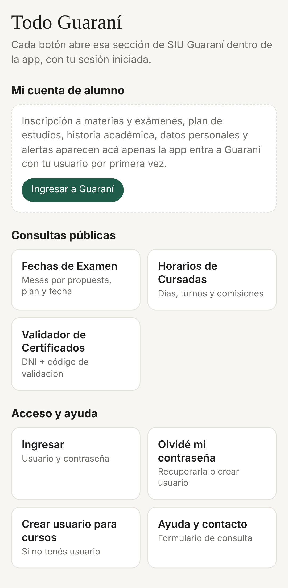

# Guaraní al día

Aplicación Android para el **SIU Guaraní del IUGNA** ([siu.iugna.edu.ar/autogestion](https://siu.iugna.edu.ar/autogestion/acceso)).
Trae Guaraní completo adentro de la app y además lo revisa sola cada cierto tiempo: cuando se carga
una nota, se abre una inscripción o cambia cualquier cosa, te llega una notificación al celular.

## Descargar

| Archivo | Qué es |
|---|---|
| [`publicado/Guarani-al-dia-1.1.apk`](publicado/Guarani-al-dia-1.1.apk) | La aplicación, lista para instalar (Android 8.0 o más nuevo). |

Descargá el `.apk` en el celular, abrilo desde *Archivos* y permití la instalación desde esta
fuente. No está en Google Play. Cada versión se firma con la misma clave, así que se instala encima
de la anterior y conserva tus datos y ajustes.

## Primeros pasos

1. Al abrirla por primera vez la app va a **Ajustes**. La dirección ya viene cargada:
   `https://siu.iugna.edu.ar/autogestion/`.
2. Poné tu **usuario y contraseña** de Guaraní. Se guardan cifrados en el teléfono (Android
   Keystore) y solo se usan para volver a entrar cuando la sesión vence. Si preferís no guardarlos,
   entrá una vez desde la pestaña **Guaraní** y la app usa esa sesión.
3. Elegí cada cuánto revisar (15 minutos a 6 horas) y tocá **Guardar y activar**.
4. Aceptá las notificaciones y tocá **Permitir que funcione en segundo plano**, para que el ahorro
   de batería no frene las revisiones.

La primera revisión **no avisa nada**: toma una foto de cómo está tu Guaraní hoy. Desde la segunda,
avisa todo lo que cambie.

## Qué tiene

**Cuatro pestañas:**

- **Tablero:** promedio, avance de la carrera, materias aprobadas y finales pendientes; novedades,
  fechas que se vienen, bandeja (mensajes, encuestas, exámenes inscriptos), estado de cada materia
  de la carrera y de la diplomatura, y materias habilitadas para rendir. Deslizá hacia abajo para
  revisar en el momento.
- **Menú:** todas las secciones de Guaraní en botones.
  - *Mi cuenta de alumno*: se arma sola con el menú real de Guaraní la primera vez que la app entra
    (inscripción a materias y exámenes, plan de estudios, historia académica, datos personales,
    mensajes y alertas).
  - *Consultas públicas*: Fechas de Examen, Horarios de Cursadas y Validador de Certificados.
  - *Acceso y ayuda*: Ingresar, Olvidé mi contraseña, Crear usuario para cursos y Ayuda y contacto.
- **Guaraní:** el sitio completo dentro de la app, con ingreso automático. Se puede hacer todo lo
  que hace la web: inscribirse, descargar certificados (van a *Descargas*) y subir archivos.
- **Ajustes:** dirección, usuario, frecuencia, avisos, y la lista de páginas que se vigilan.

**Avisos, en cuatro canales** (cada uno se puede silenciar aparte desde Android):

| Canal | Cuándo llega |
|---|---|
| Notas y actas | Se carga o cambia una nota, una promoción, una regularidad o un acta. Ejemplo: *«Instrumentos y Mediciones: aprobada con 8.»* |
| Inscripciones, períodos y vencimientos | Se abre o cierra una inscripción, aparece una mesa o turno, o un final está por vencer. |
| Otros cambios en Guaraní | Cualquier otra cosa que cambie (se puede apagar en Ajustes). |
| Estado de la sesión | Guaraní no deja entrar (clave cambiada o captcha). Avisa una sola vez. |



## Cómo funciona por dentro

- La revisión corre con **WorkManager**, así que sigue andando con la app cerrada y después de
  reiniciar el teléfono.
- Abre Guaraní en un navegador interno invisible que **comparte las cookies** con la pestaña
  Guaraní. Si la sesión venció, completa el formulario de ingreso de Guaraní (`usuario`,
  `password`) igual que una persona.
- Recorre todas las páginas del menú del alumno (hasta 30), guarda el texto de cada una y lo
  compara con la revisión anterior, línea por línea. Lo que aparece o desaparece es la novedad.
- Además busca cada materia en la historia académica para sacar **estado y nota** y actualizar el
  tablero. Entiende las formas en que Guaraní escribe una nota: `8 (Ocho)`, `Nota: 9` o letras
  como `A`.
- Nada sale del teléfono: no hay servidor propio, ni cuentas, ni terceros. Solo se habla con
  `siu.iugna.edu.ar`.

**Límites conocidos:** si Guaraní pide captcha al entrar, hay que hacerlo a mano una vez desde la
pestaña Guaraní. Fechas de Examen y Horarios de Cursadas son buscadores con filtros: se usan desde
el Menú, pero la app no los revisa sola (tus mesas sí, desde tu cuenta). Si la carrera y la
diplomatura se eligen con un selector, se vigila la que esté seleccionada; la otra se puede sumar en
*Ajustes → Páginas que se vigilan*.

## Código

| Ruta | Qué es |
|---|---|
| `app-android/app/src/main/java/ar/pariz/guarani/MainActivity.kt` | Las cuatro pestañas, descargas, subida de archivos e ingreso automático. |
| `…/Scraper.kt` | Navegador invisible: entra a Guaraní, lee el menú y recorre las páginas. |
| `…/Analyzer.kt` | Compara con la revisión anterior, saca notas y estados, y decide qué avisar. |
| `…/CheckWorker.kt`, `Scheduler.kt` | Revisión periódica en segundo plano. |
| `…/Notifier.kt` | Los cuatro canales de notificación. |
| `…/Store.kt`, `Config.kt` | Datos del tablero, fotos de cada página y credenciales cifradas. |
| `app-android/app/src/main/assets/dashboard.html` | El tablero. |
| `app-android/app/src/main/assets/menu.html` | La pestaña Menú. |
| `app-android/app/src/test/…/AnalyzerTest.kt` | Pruebas del lector de notas. |

Paquete `ar.pariz.guarani`, minSdk 26, targetSdk 35, Kotlin 2.0, Android Gradle Plugin 8.7.

### Compilar

```bash
cd guarani-al-dia/app-android
./gradlew testReleaseUnitTest assembleRelease
```

Necesita JDK 17 o más nuevo y el SDK de Android (API 35). Sin clave queda un APK sin firmar. Para
firmarlo con la clave de siempre, poné `guarani.keystore` y un `keystore.properties` en
`app-android/app/`:

```properties
storePassword=…
keyAlias=guarani
keyPassword=…
```

**La clave de firma no se sube nunca al repositorio** (está en el `.gitignore`). Si se pierde, las
versiones nuevas ya no se pueden instalar encima de las viejas.
